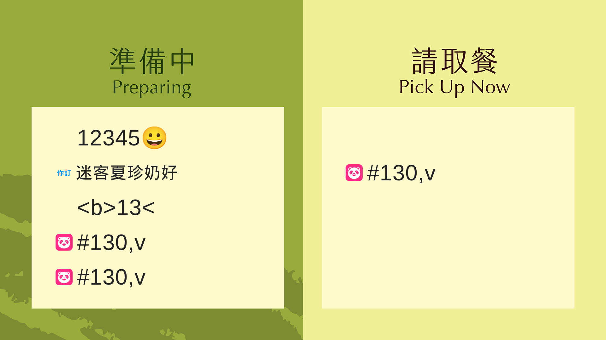

# Number display spec v2 — PR #95

| Field | Value |
| --- | --- |
| **head sha** | `950902a` |
| **asset version** | `20261019b` |
| **branch** | `cursor/controller-default-number-5dd5` |

## Spec coverage (15 items)

| # | Requirement | Test file / name | Result |
| --- | --- | --- | --- |
| 1 | As-sent display (case, `#`, leading zeros) | `tests/number-spec-v2.test.js` → spec 1 | pass |
| 2 | Max 6 grapheme/code units | `tests/number-spec-v2.test.js` → spec 2 | pass |
| 3 | Trim outer whitespace, keep inner | `tests/number-spec-v2.test.js` → spec 3 | pass |
| 4 | Empty / whitespace-only → blank cell | `tests/number-spec-v2.test.js` → spec 4 | pass |
| 5 | Dedupe source + trimmed original | `tests/number-spec-v2.test.js` → spec 5 | pass |
| 6 | Same 6-char prefix, different originals | `tests/number-spec-v2.test.js` → spec 6 | pass |
| 7 | Unknown sources hidden | `tests/number-spec-v2.test.js` → spec 7; `delivery-number-qa-live2.test.js` | pass |
| 8 | HTML escaped (plain text) | `tests/number-spec-v2.test.js` → spec 8 | pass |
| 9 | Six CJK chars in cell | `tests/number-spec-v2.test.js` → spec 9 | pass |
| 10 | Blank cells count for paging | `tests/number-spec-v2.test.js` → spec 10 | pass |
| 11 | No controller format validation | `tests/number-spec-v2.test.js` → spec 11-12; `controller-default-number.test.js` | pass |
| 12 | Rule note v2 + as-typed send | `tests/controller-source-number.test.js`; E2E `controller-default-number.spec.mjs` | pass |
| 13 | Board truncates >6 | `tests/number-spec-v2.test.js` → spec 13 | pass |
| 14 | Controller list textContent | `tests/number-spec-v2.test.js` → spec 14 | pass |
| 15 | Empty send allowed | `tests/number-spec-v2.test.js` → spec 15 | pass |

## Rewritten tests (old format rules)

- `tests/board-number-rules.test.js` (all cases)
- `tests/board-display-number-log-rules.test.js` (all cases)
- `tests/delivery-number-format.test.js` (all cases)
- `tests/delivery-number-qa-live2.test.js` (unrecognized sourceType)
- `tests/pos-ticket-cloud-sanitize.test.js` (all cases)
- `tests/controller-default-number.test.js` (B5 / defaults)
- `tests/controller-source-number.test.js` (validation cases)
- `tests/controller-store-simulation.test.js` (udd length / store `123`)
- `tests/milksha-board-official.test.js` (foodpanda)
- `tests/e2e/board-number-rules.spec.mjs`
- `tests/e2e/controller-default-number.spec.mjs`

## Unit tests

- **370** tests, **370** pass, **0** fail (`npm test`)

## E2E (local)

- `board-number-rules.spec.mjs` + `controller-default-number.spec.mjs`: **5** pass

## Screenshot (local mock)

Payload: truncate `#130,vke3…`, blank `   `, colliding `#130,va` / `#130,vb`, HTML `<b>13</b>`, six CJK `迷客夏珍奶好`, emoji `12345😀`.

## CI

- Run id: `39240970236` (first push on `9cd0de6`) — **failure**; branch-only E2E: `board-uber-six-char-column-overflow.spec.mjs` (4) — `From_WideBench_OK` dropped under spec §7; fixed to `From_UberEat_OK` in follow-up commit.
- Unique failures in that run otherwise match main baseline set (e.g. `pr23-login-count`, `cloud-remote-send`, `forbidden-store-then-qa-isolation`, …); **branch-only count after fix: 0** (await re-run on latest `HEAD`).
